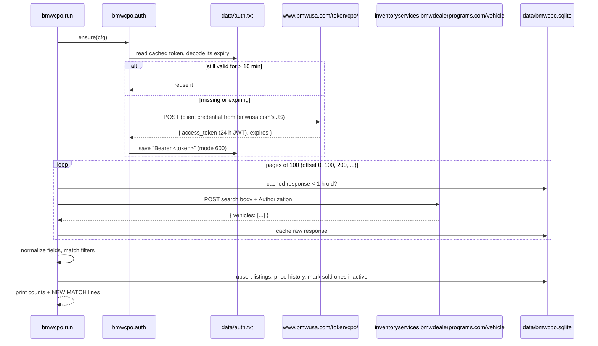

# How it works

One command, `python -m bmwcpo.run`, does everything: gets a valid API token, pages through
BMW's CPO inventory API, checks each car against what we want, saves it to SQLite, and prints
new matches.

## A run, step by step

If the inventory API rejects the token with 401/403 before its stated expiry, the client fetches
a new token and retries that page once.

## The API token

The inventory API (`inventoryservices.bmwdealerprograms.com/vehicle`) needs an
`Authorization: Bearer <token>` header. This is the part that used to need a person copying the
header out of Chrome DevTools every day. It no longer does.

**Where bmwusa.com's own page gets it.** The CPO search page's JS bundle
(`bmwusa-universal-inventory...min.js`) has a small function that runs before every search:

1. Use the token already in the app's memory if it hasn't expired.
2. Otherwise use `localStorage["access_token"]` if it hasn't expired.
3. Otherwise `POST {tokenURL}token/cpo/`, with a fixed `Authorization: Basic ...` client
   credential written into the bundle, and save the JSON response to localStorage.

`tokenURL` is set in another bundle file (`paths2.js`) to the site's own origin, so the request
goes to `https://www.bmwusa.com/token/cpo/`. The client credential is the same for every
visitor. It identifies the website, not a person, and nobody logs in.

**What we do.** [`bmwcpo/auth.py`](../bmwcpo/auth.py) makes that same POST, with the same
headers, and stores `Bearer <access_token>` in `data/auth.txt`. The URL and client credential
are in [`config.toml`](../config.toml) under `[token]`.

**What the token is.** It's a JWT: three base64 parts separated by dots. The middle part is
readable JSON, and it says the token was issued by Shift Digital (BMW's dealer-platform vendor)
with role `API`. The `iat` (issued) and `exp` (expires) fields are exactly 86,400 seconds apart,
so a token lasts **24 hours**. `bmwcpo.auth` reads `exp` to decide when to refresh. To check
the current token's expiry without printing it:

    python -m bmwcpo.auth        # "auth still valid (expires 2026-11-16 23:20)"

**Order of preference** in `auth.ensure()`:

| Source | When it's used |
|---|---|
| `BMW_AUTH` env var | If set, used as-is. Useful for a one-off test with a hand-copied value. |
| `data/auth.txt` | If it holds a JWT with more than 10 min left, or a non-JWT value (trusted as-is). |
| Fresh fetch | Otherwise, if `[token] auto_refresh = true` (the default). |

The token value never appears in output, logs or error messages. Errors say only things like
`token endpoint returned HTTP 401`.

## Matching

[`bmwcpo/filters.py`](../bmwcpo/filters.py) and [`bmwcpo/codes.py`](../bmwcpo/codes.py) decide
whether a car matches. All three conditions must hold:

| Check | How |
|---|---|
| 3 Series | `modelSeries` / `model` mentions 3 Series, 330, or M340 |
| Color | `exterior` name contains "brooklyn grey" or "portimao blue". The API gives no paint code, so this is by name. |
| Options | `allCodes` (e.g. `0337\|05AU\|...`) contains both **337** (M Sport) and **5AU** (Driving Assistant Professional). Codes are zero-padded, and `normalize_code` strips the pad. |

Edit `REQUIRED_OPTION_CODES` and `WANTED_COLORS` in `codes.py` to hunt for something else.

## Storage

`data/bmwcpo.sqlite` (schema in [`schema.sql`](../schema.sql)):

| Table | Holds |
|---|---|
| `listings` | One row per VIN: price, miles, dealer code, distance, URL, option codes, `is_match`, `first_seen`/`last_seen`, `active` |
| `price_history` | A row each time a VIN's price changes |
| `raw_responses` | Raw API pages, reused for 1 hour (`cache_ttl_seconds`) so reruns don't hit BMW |

A "NEW MATCH" is a matching VIN the database has never seen. A listing missing from a run is
marked `active = 0` (sold or delisted). Keep `data/` between runs, or every match counts as new.

## Code map

| File | Job |
|---|---|
| [`bmwcpo/run.py`](../bmwcpo/run.py) | Entry point: loop over listings, match, store, print |
| [`bmwcpo/auth.py`](../bmwcpo/auth.py) | Get or refresh the API token (also a CLI: `python -m bmwcpo.auth`) |
| [`bmwcpo/client.py`](../bmwcpo/client.py) | Build requests from `config.toml`, page through results, cache, retry on 401 |
| [`bmwcpo/filters.py`](../bmwcpo/filters.py), [`codes.py`](../bmwcpo/codes.py) | What counts as a match |
| [`bmwcpo/db.py`](../bmwcpo/db.py) | SQLite helpers |
| [`config.toml`](../config.toml) | Search ZIP and radius, API request shape, token endpoint, field mapping |
| [`scripts/daily.sh`](../scripts/daily.sh) | Scheduled wrapper that logs only counts, new matches and errors |
| [`scripts/save_auth.sh`](../scripts/save_auth.sh) | Manual fallback: paste a header copied from DevTools |
