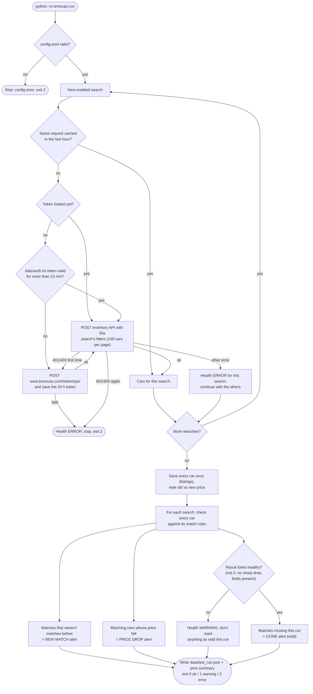

# How it works

One command, `python -m bmwcpo.run`, does everything:
1. Gets a valid API token.
2. Runs each saved search against BMW's CPO inventory API.
3. Checks the returned cars against that search's rules and saves them to SQLite.
4. Reports what changed: new matches, price drops, sold cars and health problems. The report
   goes to the screen and to `data/last_run.json`.

## A run, step by step

The first time a search runs, it's a **baseline**. Its current matches are listed once as
`search_started`, not as dozens of "new" alerts.

## Searches: filters vs match

Each `[[searches]]` block in `config.toml` has:
- **`filters`**, sent to BMW, so BMW returns only those cars. These must be exact facet values.
- **`match`**, checked locally on each car: option codes, paint names, price, miles, distance
  and year limits.

There are two default searches:
- **`g20-msport-dap-pro`** filters on 3 Series, CPO, M Sport Package and Blue/Gray on BMW's
  side. It then checks Driving Assistant Professional (5AU) and the exact paints locally.
  That's **1 request**.
- **`dap-pro-hud`** wants DAP Pro plus a Head-up Display in any color. Neither can be filtered
  on BMW's side (HUD is code 6U3, and the API's HUD filter only knows the rare 610), so it scans
  every CPO 3 Series. That's **about 11 requests**.

Machine-specific changes go in a git-ignored `config.local.toml` that's merged on top. Full
guide, including every filter value and how values combine: [searches.md](searches.md).

## Alerts

| Alert | When |
|---|---|
| `new_match` | A car matches a search and wasn't an active match for it last time. That covers new listings, cars that start matching (e.g. a price drop below `max_price`), and relisted cars. |
| `price_drop` | A matching car's price is at least `[alerts] min_price_drop` lower than its last price |
| `match_gone` | A car that was a match is no longer returned. Usually sold. |
| `search_started` | The first run of a search; lists its current matches once |
| `health` | Something is wrong; see below |

## Health checks

| Check | Level | Notes |
|---|---|---|
| Token can't be fetched, or the API rejects it twice | error | The run stops; the other searches are skipped |
| A search's request fails (HTTP 5xx, network) | error | The other searches still run |
| Config has an unknown filter name | warning | Probably a typo |
| A search returns 0 cars | warning | Filters too narrow, or the API changed |
| A search returns less than half its last count | warning | Reported once; that count becomes the new normal |
| Fewer cars fetched than BMW says exist | warning | Raise `[api] max_pages` |
| More than half the cars lack codes, color or price | warning | The API response shape probably changed |

When a search looks unhealthy, nothing is marked as sold that run. That prevents a flood of
false "gone" alerts when the API hiccups. The agent running this also watches for staleness
(no successful run in 36 hours); see [AGENTS.md](../AGENTS.md).

## The API token

The inventory API needs `Authorization: Bearer <token>`. bmwusa.com's own CPO page gets one
like this, in its JS bundle (`bmwusa-universal-inventory...min.js`):

1. Use the token in the app's memory if it hasn't expired.
2. Otherwise use `localStorage["access_token"]` if it hasn't expired.
3. Otherwise `POST https://www.bmwusa.com/token/cpo/`, with a fixed `Authorization: Basic ...`
   client credential written into the bundle (the same for every visitor; nobody logs in).

[`bmwcpo/auth.py`](../bmwcpo/auth.py) makes that same POST and stores `Bearer <access_token>`
in `data/auth.txt` (mode 600, git-ignored). The token is a JWT whose `iat` and `exp` are
86,400 seconds apart, so it lasts **24 hours**. The token is only fetched when a request is
actually needed, so a fully cached run doesn't touch it.

| Source, in order | When it's used |
|---|---|
| `BMW_AUTH` env var | If set, used as-is |
| `data/auth.txt` | If it has more than 10 minutes left (or isn't a JWT) |
| Fresh fetch | Otherwise (`[token] auto_refresh = true`) |

To check expiry without printing the token: `python -m bmwcpo.auth`.

## Storage

`data/bmwcpo.sqlite` (schema in [`schema.sql`](../schema.sql)):

| Table | Holds |
|---|---|
| `listings` | One row per VIN: latest price, miles, dealer, URL, option codes, raw JSON |
| `price_history` | A row each time a VIN's price changes |
| `search_hits` | One row per (search, VIN): `is_match`, distance, `first_matched`, `active` (still returned by that search) |
| `search_stats` | Last healthy result count per search, for the sharp-drop check |
| `runs` | Every run's status, request count and full JSON report |
| `raw_responses` | Raw API pages, reused for 1 hour (`cache_ttl_seconds`) |

## Code map

| File | Job |
|---|---|
| [`bmwcpo/run.py`](../bmwcpo/run.py) | Entry point: run searches, detect alerts, health checks, report, `--dry-run` |
| [`bmwcpo/config.py`](../bmwcpo/config.py) | Load and validate `config.toml`; build each search's request body |
| [`bmwcpo/client.py`](../bmwcpo/client.py) | HTTP client: token on demand, paging, cache, delays, 401 retry, request count |
| [`bmwcpo/auth.py`](../bmwcpo/auth.py) | Get or refresh the API token (also a CLI) |
| [`bmwcpo/filters.py`](../bmwcpo/filters.py) | Local match rules |
| [`bmwcpo/codes.py`](../bmwcpo/codes.py) | Option-code normalization and reference |
| [`bmwcpo/db.py`](../bmwcpo/db.py) | SQLite helpers |
| [`bmwcpo/facets.py`](../bmwcpo/facets.py) | `python -m bmwcpo.facets`: list filter values and counts |
| [`scripts/daily.sh`](../scripts/daily.sh) | Scheduled wrapper; appends the summary to `data/daily.log` |
| [`scripts/save_auth.sh`](../scripts/save_auth.sh) | Manual fallback: paste a header copied from DevTools |
